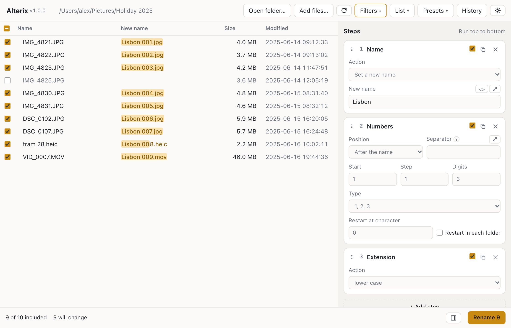
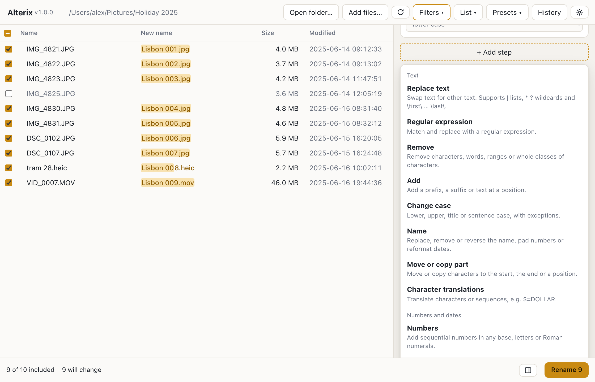
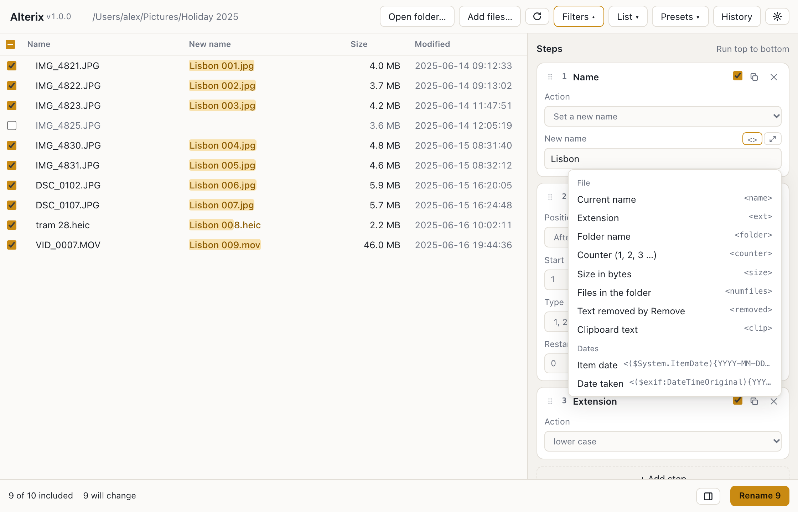
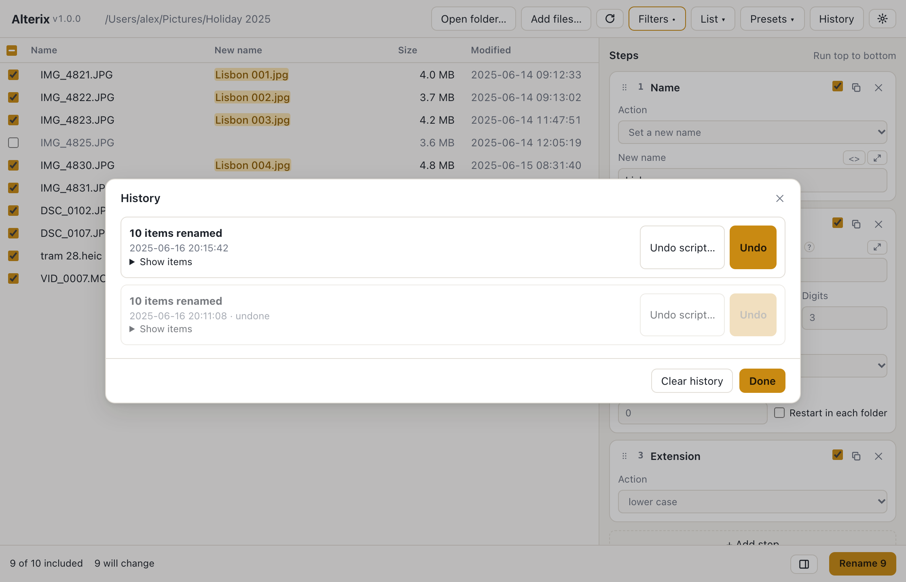
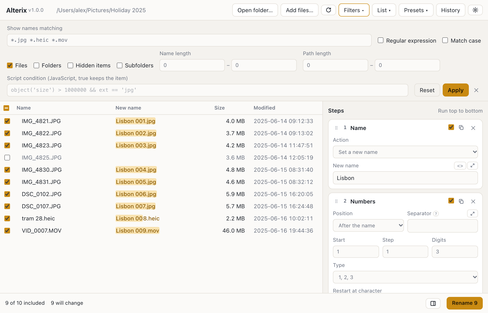
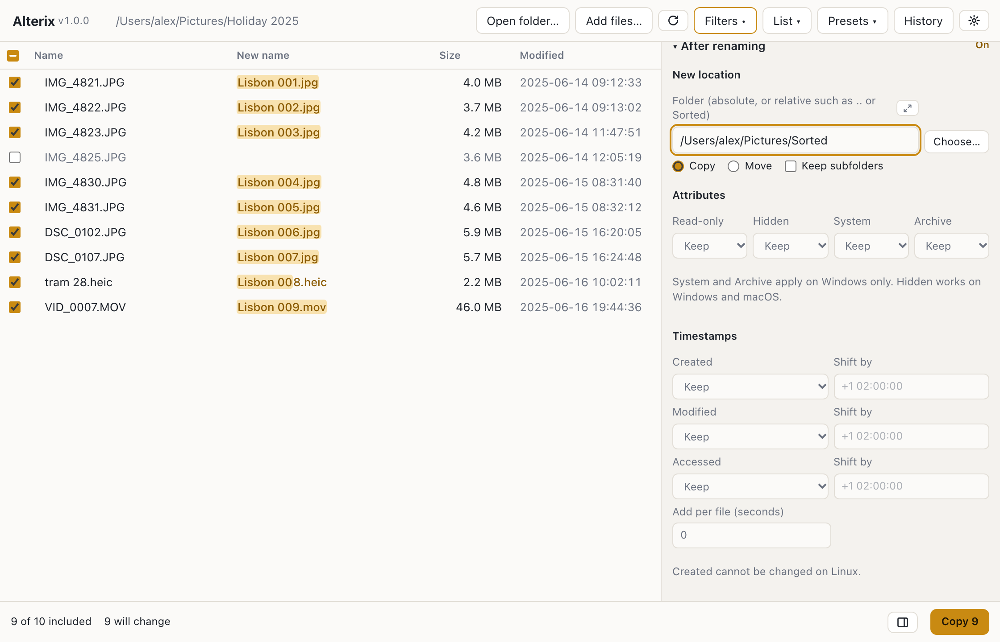
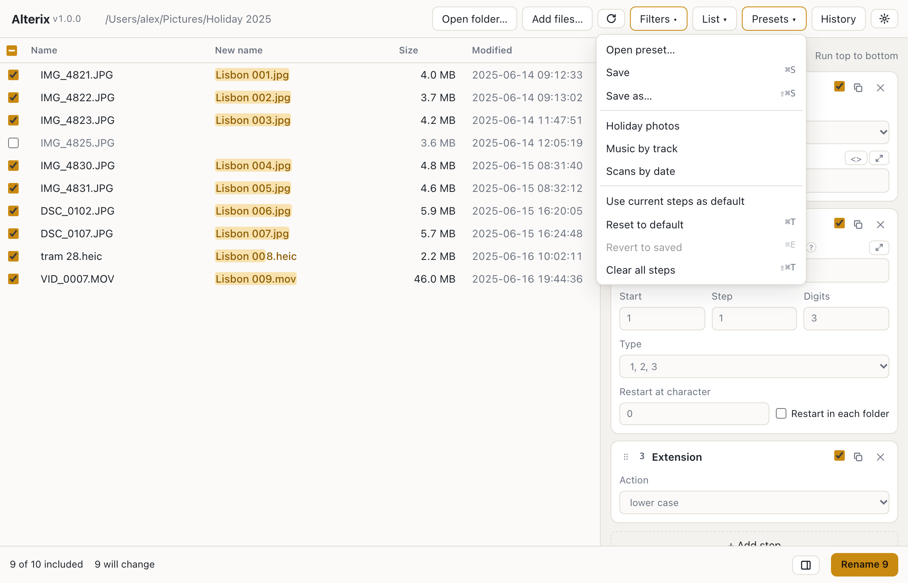
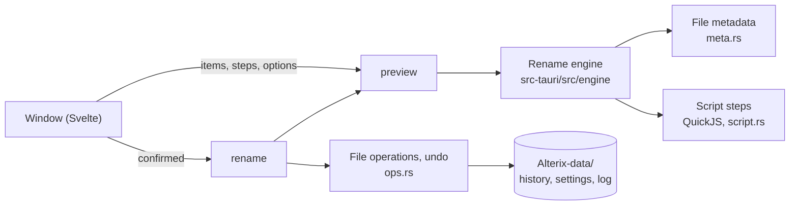

Alterix renames many files at once, shows each new name before anything changes, and can undo every rename. Works offline. Sends no data.

**Contents:** [What it does](#what-it-does) · [Privacy](#privacy) · [Download](#download) · [How to use](#how-to-use) · [Report a problem](#report-a-problem) · [For developers](#for-developers)

<picture>
  <source media="(prefers-color-scheme: dark)" srcset="assets/screenshots/main-dark.png">
  
</picture>

## What it does

Alterix is a free renamer for Windows, macOS and Linux. Every renaming tool you need is in one clear window.

### See every new name first

The list shows each file's new name as you type. Changed text is highlighted. Names that clash, or that would break on another system, are marked before you rename.

### Build names from simple steps

<picture>
  <source media="(prefers-color-scheme: dark)" srcset="assets/screenshots/add-step-dark.png">
  
</picture>

Add steps such as **Replace text**, **Remove**, **Add**, **Change case**, **Numbers**, **Date** and **Folder name**. Steps run from top to bottom. Drag a step to change the order, or switch it off to see the difference.

### Use what is inside your files

<picture>
  <source media="(prefers-color-scheme: dark)" srcset="assets/screenshots/tags-dark.png">
  
</picture>

Name photos by the date they were taken or the camera that took them. Name music by artist, album and track. Name documents by their PDF title. Tags such as `<(exif:Model)>` and `<($exif:DateTimeOriginal){YYYY-MM-DD}>` insert these values.

### Undo any rename

<picture>
  <source media="(prefers-color-scheme: dark)" srcset="assets/screenshots/history-dark.png">
  
</picture>

Every rename goes into **History**. Select **Undo** to put the old names back, even after you restart Alterix.

### Pick exactly which files

<picture>
  <source media="(prefers-color-scheme: dark)" srcset="assets/screenshots/filters-dark.png">
  
</picture>

Show only some files with masks such as `*.jpg !*_old.*`. Include subfolders, hidden files or folders. Tick or untick each item to decide what is renamed.

### Move, copy and tidy at the same time

<picture>
  <source media="(prefers-color-scheme: dark)" srcset="assets/screenshots/after-renaming-dark.png">
  
</picture>

Copy or move renamed files to another folder. Set file dates and attributes in the same run.

### Save your recipes

<picture>
  <source media="(prefers-color-scheme: dark)" srcset="assets/screenshots/presets-dark.png">
  
</picture>

Save the steps as a preset and open it again later. A preset named `_autoload.alterix` in a folder loads when you open that folder.

## Privacy

- Your files never leave your computer. Alterix works offline.
- No accounts, no tracking, no adverts.
- Settings, history and logs are kept in the `Alterix-data` folder next to the app. Nothing is written anywhere else.
- When you select the version number, the app asks GitHub (api.github.com) for the latest release. It sends nothing else and nothing is downloaded.
- **Report a Problem** opens a page on GitHub in your browser. Nothing is sent until you submit it there.
- The app keeps a log file, `Alterix.log`, in the `Alterix-data` folder. It records what the app does and any errors, including file names, to help fix problems. It never leaves your computer unless you send it. To find it, select **View Logs** in Settings.
- **Open in Alterix** is off until you add it in Settings. It adds a menu item to your file manager, outside the `Alterix-data` folder.

## Download

Alterix runs on Windows 10 or later, macOS 11 or later on Apple Silicon, and Linux (x64).

1. Open the [Releases page](https://github.com/TariqMK/Alterix/releases).
2. Download the file for your system:
   - Windows: `Alterix-vX.Y.Z-windows-x64.exe`
   - macOS: `Alterix-vX.Y.Z-macos-arm64.zip`
   - Linux: `Alterix-vX.Y.Z-linux-x64.AppImage`
3. Put it in a folder you can write to, for example your Applications or Documents folder.
4. Open it. On macOS, unzip it first. On Linux, mark the file as executable first.

> [!NOTE]
> Alterix keeps its data in an `Alterix-data` folder next to the app. Move both together to take your settings with you.

### Opening on macOS

Alterix isn't notarised by Apple, so macOS shows a warning the first time you open it. This is expected and doesn't mean the app is harmful.

1. Open Alterix and click **Done** on the warning.
2. Open **System Settings → Privacy & Security**, scroll down to the message saying "Alterix" was blocked, and click **Open Anyway**.
3. Enter your password, then click **Open** on the next prompt. You only need to do this once.

If you use Terminal

You can run this instead:

    xattr -dr com.apple.quarantine "/Applications/Alterix.app"

## How to use

### Rename files

1. Select **Open folder…** and choose a folder. You can also drop files or folders onto the window.
2. Select **+ Add step** and choose a step, for example **Replace text**.
3. Fill in the step. The **New name** column updates as you type.
4. Add more steps if you need them. Drag a step by its handle to change the order.
5. Untick any item you want to leave as it is.
6. Select **Rename**.

> [!TIP]
> Select an item and press F2 to rename just that item by hand.

### Undo a rename

1. Select **History**.
2. Select **Undo** next to the rename you want to reverse.

### Rename from a list

1. Select **List › Rename pairs…**.
2. Select **Import from file…** or **Import from clipboard**. Each line is `old name|new name`. A comma or a tab also works.

### Save and reuse steps

1. Select the presets button (**Presets ▾**) › **Save as…**.
2. To use the steps again, select **Presets ▾** › **Open preset…** or choose a recent preset.

### Check for updates

1. Select the version number next to **Alterix** at the top of the window.
2. If a newer version exists, select **Open release page** and download it.

### Add "Open in Alterix" to your file manager

1. Select the settings button (gear icon) › **Data and integration**.
2. Under **Open in Alterix**, select **Add**.

## Report a problem

You need a free GitHub account to report a problem or suggest an idea.

- In Alterix, select Settings › **Data and integration** › **Report a Problem…** (on macOS also **Help › Report a Problem…**). Your Alterix version and system are filled in for you.
- [Report a bug](https://github.com/TariqMK/Alterix/issues/new?template=bug.yml)
- [Suggest an idea](https://github.com/TariqMK/Alterix/issues/new?template=idea.yml)

## For developers

Building the app yourself or changing it? Everything you need is below.

<strong>Run from source</strong>

You need [Rust](https://rustup.rs) (stable) and [Node.js](https://nodejs.org) (LTS). On Linux, also install Tauri's system packages: `libwebkit2gtk-4.1-dev libgtk-3-dev librsvg2-dev libayatana-appindicator3-dev`.

1. Install the packages:

       npm install

2. Start the app:

       npm run app

A source run shows the version `v0.0.0-dev` and keeps its data in `Alterix-data/` in the project folder.

<strong>Run the tests</strong>

    npm test        # Rust engine tests and front-end tests
    npm run lint    # Prettier, svelte-check, rustfmt and clippy

<strong>How it works</strong>

Alterix is a [Tauri 2](https://tauri.app) app. The window is Svelte 5; all renaming logic is Rust.

- The rename command always runs the preview again in Rust, so it never trusts a stale preview.
- Folder contents are renamed before their folder. Swaps and chains (a→b, b→a) go through a temporary name.
- Replaced files go to the system trash, never straight to deletion.

<strong>Update the screenshots</strong>

The screenshots show the real Alterix window with made-up files. The new names come from the real rename engine. To retake them in light and dark into `assets/screenshots/`, run this from the project folder:

    npx playwright install chromium    # once
    node assets/make_screenshots.mjs

<strong>Update the brand images</strong>

The master icon is `assets/icon/alterix.svg`. Colours, fonts and the tagline are in `assets/brand.json`. To rebuild the icon files, `src-tauri/icons/`, the banner and the social card, run this from the project folder (needs [uv](https://docs.astral.sh/uv/) and Node.js):

    uv run --python 3.12 --with PySide6 assets/make_assets.py

<strong>Creating a Release</strong>

Releases are built by GitHub Actions (`.github/workflows/release.yml`). The workflow never commits or pushes.

1. On GitHub, open **Actions › Release › Run workflow**.
2. Under **Use workflow from**, pick `main` for a normal release.
3. Choose **draft** (only you can see it) or **public**.
4. Choose **patch**, **minor** or **major**.
5. Select **Run workflow**.

The workflow runs the lint and tests, works out the next version from the existing tags and releases (drafts included), builds Windows, macOS (Apple Silicon) and Linux, then tags the built commit and creates the release "Alterix vX.Y.Z" with automatic notes.

- Windows: a single `.exe`. macOS: the `.app` in a `.zip`. Linux: a single `.AppImage`.
- The version comes from the tag. It is written into `src-tauri/Cargo.toml` on the build machine only.
- No secrets are needed. The macOS app is not signed or notarised.

**Branch builds.** To test a branch, pick it under **Use workflow from**. The version looks like `v1.5.0-new-sync.1`: the next version, the branch name and a build number. **Public** makes a GitHub pre-release, which is never shown as the latest release. Merge the branch into `main` and run a normal release when it is ready.

## Licence

Alterix is free software under the [GNU General Public License v3.0](LICENSE).
